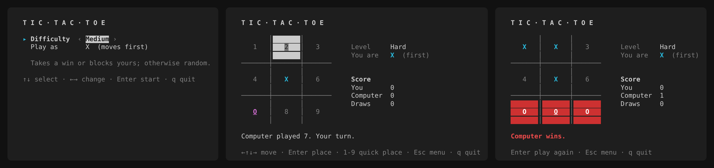

# Legacy C++ version

The command-line tic-tac-toe game this repository started as, and a portable C++20 rewrite of
it for macOS, Linux and Windows terminals. Independent of the web app: nothing in this
directory is part of the Expo/Vercel build.



## Quick start

Requirements: CMake ≥ 3.20 and a C++20 compiler (GCC ≥ 11, Clang ≥ 14, Xcode Command Line
Tools, or MSVC 2022). From the repository root:

```bash
cd legacy/cpp
```

```bash
cmake -S . -B build -DCMAKE_BUILD_TYPE=Release
```

```bash
cmake --build build
```

```bash
./build/tictactoe
```

On Windows the binary is `build\Release\tictactoe.exe`.

## Features

- Three difficulty levels:
  - **Easy** – plays a random empty cell.
  - **Medium** – takes a winning move if one exists, otherwise blocks yours, otherwise plays
    randomly.
  - **Hard** – perfect play via minimax; cannot be beaten (best result is a draw).
- Play as Player 1 (X, moves first) or Player 2 (O, moves second).
- Full-screen keyboard interface: coloured marks, highlighted cursor and winning line, last
  computer move underlined, running score across games.
- Plain line-based mode for pipes and scripts.

## Controls

| Key | Menu | Game | Game over |
|---|---|---|---|
| `↑` `↓` / `w` `s` / `k` `j` | Select field | Move cursor | – |
| `←` `→` / `a` `d` / `h` `l` | Change value | Move cursor | – |
| `1`–`9` | Set value | Place mark on that cell | – |
| `Enter` / `Space` | Start | Place mark at cursor | Play again |
| `Esc` / `m` | Quit | Back to menu | Back to menu |
| `q` / `Ctrl-C` | Quit | Quit | Quit |

Cells are numbered 1–9, left to right, top to bottom:

```
 1 | 2 | 3
---+---+---
 4 | 5 | 6
---+---+---
 7 | 8 | 9
```

## Command-line options

| Flag | Effect |
|---|---|
| `--plain` | Line-based prompts instead of the full-screen interface; type `q` to quit. Used automatically when stdin/stdout is not a terminal. |
| `--no-color` | Disable colours. Also disabled when `NO_COLOR` is set to a non-empty value. |
| `--help` | Show usage. |

## Development

Run the tests (from `legacy/cpp/`, after building):

```bash
ctest --test-dir build --output-on-failure
```

The suite includes an exhaustive search over every opponent move sequence, verifying that Hard
never loses as either X or O, plus tests for the board, the other AI levels, both interfaces
and key decoding.

Check formatting:

```bash
clang-format --dry-run --Werror src/main.cpp src/tictactoe/* tests/*.cpp
```

CMake options:

| Option | Default | Effect |
|---|---|---|
| `TICTACTOE_BUILD_TESTS` | `ON` | Build the `tictactoe_tests` target |
| `TICTACTOE_WARNINGS_AS_ERRORS` | `OFF` | Add `-Werror` / `/WX` |

CI ([`.github/workflows/legacy-cpp.yml`](../../.github/workflows/legacy-cpp.yml)) builds and
tests with GCC, Clang, Apple Clang and MSVC, runs AddressSanitizer/UBSan and checks formatting.
It runs only when files under `legacy/cpp/` change.

## Layout

```
TICTACTOE.CPP             original Turbo C++ program (reference only, not built)
CMakeLists.txt            build for the C++20 version
.clang-format             code style
src/main.cpp              entry point, command-line options
src/tictactoe/board.*     board state, win/draw detection
src/tictactoe/ai.*        computer strategies per difficulty
src/tictactoe/tui.*       full-screen interface (rendering, input handling)
src/tictactoe/terminal.*  raw keyboard input and screen control (POSIX / Windows)
src/tictactoe/game.*      plain line-based mode
tests/tests.cpp           unit and integration tests
```

## Original version

[`TICTACTOE.CPP`](TICTACTOE.CPP) is the original program, kept unchanged: a single-file game
written in Turbo C++ on Windows 7 for 16-bit DOS, drawn with the BGI graphics library, with
Easy, Medium and Difficult levels and a choice of playing first or second. It depends on
`conio.h`, `graphics.h`, `bios.h` and the BGI driver, so it builds only with Turbo C++ (or in
DOSBox). Its commits are the first five in the repository history (`git log c52bd98`).
